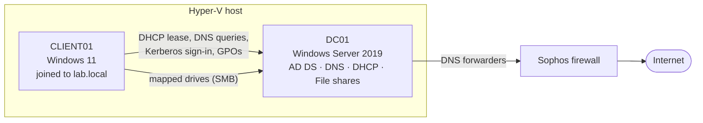
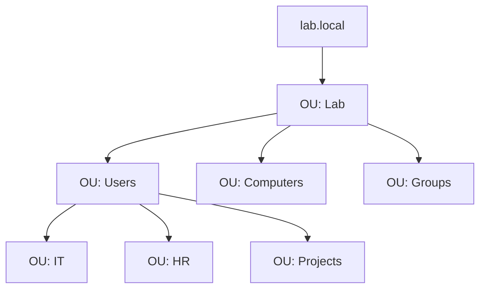

# Windows Server Active Directory Lab

A small company network built from scratch on **Hyper-V**: a **Windows Server 2019** domain controller running **Active Directory Domain Services, DNS, DHCP and file services**, with a **Windows 11** client joined to the domain and managed through **Group Policy**.

## Overview

| Item | Value |
|---|---|
| Hypervisor | Hyper-V |
| Server | Windows Server 2019 (Desktop Experience) |
| Domain | `lab.local` |
| Roles | AD DS, DNS, DHCP, File and Storage Services |
| Client | Windows 11, domain-joined, signed in as **LabUser1** |
| Upstream | DNS forwarders point to the Sophos firewall (see my [Sophos Firewall lab](https://github.com/jddeclercq/sophos-firewall-home-lab)) |

## Architecture

## What I built

### 1. Domain controller
- Installed Windows Server 2019 with the Desktop Experience on a Hyper-V VM and gave it a **static IP address**.
- Added the **Active Directory Domain Services** role and promoted the server to the first domain controller of a new forest, **lab.local**.
- AD DS installed **DNS** alongside it, with an **AD-integrated zone** for `lab.local`.

### 2. DNS
- Used the domain controller as the DNS server for the whole network, so clients can find the domain.
- Configured **forwarders** to the Sophos firewall, so internet names are resolved upstream while `lab.local` is answered locally.

### 3. DHCP
- Installed and **authorised** the DHCP server in Active Directory.
- Created a scope for the **10.0.0.0/24** network, handing out the default gateway and the DC as the DNS server.
- Added a **reservation** for my client machine, so it always gets the same address.

### 4. Users, groups and OUs
- Built an **organisational unit (OU)** structure so users and computers can be managed and targeted by Group Policy separately.
- Created **user accounts**, including **LabUser1**, and **security groups** per department.
- Gave access to **groups rather than individual users**, so a new starter only needs to be added to the right group.

### 5. File shares and permissions
- Created a main share called **Lab** with four department folders: **Projects, IT, Company and HR**.
- Kept **share permissions** broad and used **NTFS permissions** for the real access control, which is the standard approach because the most restrictive of the two always wins.
- Removed inherited permissions where needed so departments can only see what they should.

| Folder | IT | HR | Projects | All staff |
|---|---|---|---|---|
| Company | Modify | Read | Read | Read |
| IT | Full control | No access | No access | No access |
| HR | No access | Modify | No access | No access |
| Projects | Modify | No access | Modify | No access |

### 6. Group Policy
- **Mapped drives:** department folders map automatically at sign-in, based on group membership.
- **Password policy:** set in the Default Domain Policy (minimum length, complexity, maximum age and account lockout).
- Linked GPOs to the right OUs and confirmed they applied on the client.

### 7. Windows 11 client
- Built a Windows 11 VM on the same Hyper-V network, which received its address from DHCP.
- **Joined it to `lab.local`**, signed in as **LabUser1**, and tested drives, permissions and policies.

## Key decisions

| Decision | Why |
|---|---|
| Static IP on the DC | Clients depend on it for DNS and authentication, so its address must never change |
| DC as the only DNS server for clients | Domain join and sign-in rely on AD's DNS records |
| Forwarders to the firewall | Local names stay internal; everything else goes upstream |
| Permissions granted to groups | Easier to manage and audit than per-user permissions |
| Broad share permissions, strict NTFS | One place to manage access, with no conflicting rules |
| GPO-mapped drives | Users get the right drives automatically, on any domain PC |

## Validation

- The client received an address from **DHCP**, and the reservation held.
- `nslookup lab.local` from the client resolved to the domain controller.
- The **domain join** succeeded, and LabUser1 could sign in.
- `gpresult /r` on the client showed the GPOs applied, and **mapped drives** appeared at sign-in.
- Each department could reach **only its own folders**; access to others was denied.
- The **password policy** was enforced when changing a password.

## What I learned

- **DNS is the backbone of Active Directory.** Most domain-join and sign-in problems come back to DNS.
- **Share vs NTFS permissions:** both apply, and the most restrictive wins.
- **Group Policy order:** local, site, domain, OU, with the closest link applying last.
- Running `gpupdate /force` and `gpresult /r` speeds up testing considerably.

> Names, IP addresses and permission values shown here are representative of the lab.
